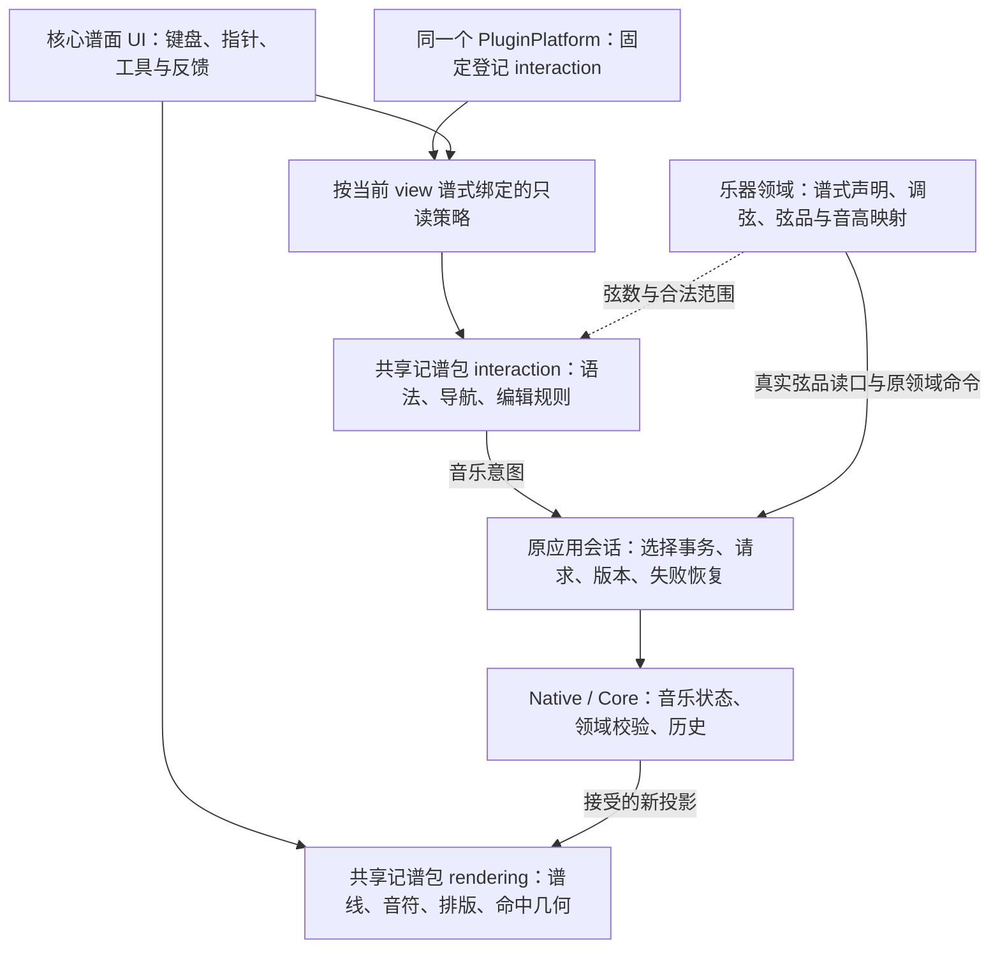

# 记谱包架构与接入 v0.1

日期：2026-10-12。此页描述当前切片和后续接缝，不将待实现能力当作现成 API。

记谱是一个共享包，内部按绘制、谱式策略和编辑机制拆模块。核心谱面 UI 在 UI 包里连接这些模块；
内部模块不用各自成为平台插件。平台只登记需要贡献、配置和生命周期的正式包。

三个维度分开：乐器是吉他/贝斯/钢琴；谱式是五线谱/Tab/简谱；输入方式是音名/数字/指针等。
当前协议每个谱式一个默认策略，支持按 view 同时绑定不同 kind；多输入方式选择尚未开放。
吉他以后声明需要 staff/tab，不重新编写两套绘制器；四线/六线由真实乐器弦数决定。

## 本轮具体改变

1. 原工作台的18个纯模块迁入 `shared/notation/interaction`，原路径保留兼容导出。
   音名、时值、变音、导航与编辑规则仍使用成熟实现。
2. `notation.core` 成为真实4.0包，在原 UI 贡献外登记 `notation.staff.interaction`。
   应用注入本包限定只读目录，正式 mount 缺目录或缺谱式会失败。
3. 当前输入和选择 owner 经绑定调用 translate、readDraft、startComposition、navigate、edit。
   不建立全局“当前谱式”，不增加命令 router、作品、选择或历史副本。
4. 修复捕获边界：SDK 不保留适配器的私有 draft 方法，translate 改为调用保留的纯规则依赖。

例如输入 C4：原键盘边界与 UI 命令认领 C，staff 策略产生音名草稿；再输入4产生音乐意图，
原应用捕获当前光标、作品 ID、版本与请求 ID，沿宿主命令提交。接受的新投影驱动重绘。
如果回执丢失，仍沿原显式重读恢复，不因策略迁移自动重发。

## 当前完成范围和下一步

| 项目 | 当前状态 |
| --- | --- |
| 五线谱纯规则归属、正式贡献与实际 UI 消费 | 已接线；具体检查结果见本轮证据 |
| 通用信号/意图、按 kind 登记、按 view 绑定 | 已有协议和接口回归 |
| Tab 数字策略、真实宿主投影与选中单音的弦品事务 | 已有窄链路；原吉他/四弦领域、历史和codec回归 |
| Tab 绘制与同次命中 | 共享单音/休止绘制已实现；4/6弦真实引擎专项，DOM/指标为替身 |
| Native 固定乐器领域和同版双谱读取 | 调号＋吉他共用原 integrated 会话；288条原TS回调差分、真实双谱/历史/物理文件回归通过 |
| 原typed/Native弦品动作与documentSession | 已接已有单音、真实范围、Tab能力、历史/物理文件及坏回执恢复 |
| 统一品位与旧文件兼容 | 新吉他schema 2无24品默认，物理末品不挡记谱；原schema 1严格兼容和首次有效修改原子升级 |
| 数百/数千品的真实音高 | 按2026-10-12需求收敛延期，不作为Tab接入前置；当前Core octave0..8超范围原子拒绝 |
| Tab 空拍插入与实际 UI | 待实现；当前界面仍为五线谱 |
| 异步编辑协调器完全支持多谱式 | 当前仍消费 StaffView，待真实 Tab 需求验证后提取 |
| 实际桌面输入手感、稳定重绘、IME | 待集中打磨和原生实测 |

已核对并接通原吉他领域的底层弦品读取/修改，共享Tab绘制与同次数字命中已实现；
真实Native与Node宿主已返回同快照双谱，窄弦品写口已接原documentSession；接续实际UI消费和原输入协调。
同一事件的五线谱/Tab 投影必须来自同一作品，编辑任一谱式沿同一历史；
吉他负责标准调弦与弦品音高映射。用实际两种策略验证共同机制后再提取协调器，
不提前建多级平台或用假 Tab 输出填补缺口。

当前Tab进展：策略输出明确的弦品属性，宿主按事件的稳定Note ID准备原set-position命令，
不在共享模块换算吉他音高；实际领域在一次事务更新两个事实。当前数字以Enter确认，
不把它称为成熟数字输入手感。原ScoreSessionRead现在增加tablature字段，保留notation的
五线谱兼容结构；旧宿主缺字段仍可接受，当前宿主总返回Tab或明确unsupported。
两谱在原读取中共用一个document snapshot、版本和warnings，不另读一份作品。
宿主prepare已挂到原公开set-fretted-position动作；Native可信定位事件的唯一Note，
同一documentSession提供窄入口，拒绝UI命令ID/音高及不匹配回执；
现有新建仍为通用五线谱，不自动初始化吉他。原协调器与四栏保持；
新弦品入口按Tab支持判断，history可用于支持staff或Tab的同一作品，不以staff音域限制Tab。
Tab复用原A4自然排版、节奏及完整SVG组合；数字命中读取实际绘制的digit Element，
不是TabNote继承的空包围盒。弦数来自投影，4/6弦使用对应标记，数字字体采用原入口加载的Academico。
此切片没有新增乐器专属渲染器、平台、命令router或作品状态。
已定位音符的普通五线谱音高修改或删除若造成领域事实不一致，会被原子拒绝；
后续必须通过原领域事务提供位置调整和关系清理，不能绕过保护实现表面上的可编辑。
五种技巧的事实可保留、校验，但当前staff/Tab/playback尚不能完整表达，均返回unsupported。
已完成的品位切片解耦了物理事实与记谱规则；新schema 2的fretCount:null表示
未提供物理末品，不设置24或999等默认，不加模式开关。原schema 1仍严格解码，读/no-op不迁移，
首次有效领域修改沿同一事务升级为2，undo恢复原块。旧V1工厂保留原物理范围语义；
既有领域贡献ID/API名称中的v1属于原ABI身份，不能据此把schema 2当成旧数据解码。
共享wire/数字草稿支持非负安全整数，但真实written pitch仍须当前Core octave0..8可表示。
标准第一弦43品/第六弦67品可写B8，下一品及100/1000品原子拒绝，不夹音高或造第二份Tab作品。
VexFlow长数字绘制验证只证明投影的原样显示/命中，不赋予该作品保存资格。

用户于2026-10-12明确不需要100品，只需适度扩展。现有范围足以推进当前需求，
大音域文件/音高演进延期；不新增固定物理末品或普通/扩展模式。
下一项按view消费真实Tab投影及已有窄弦品动作，接原选择/输入协调，
随后做吉他新建、空拍插入和关系清理。当前四栏及五线谱界面不因本轮文档收敛改变。
公开写口、错误矩阵及真实文件验证见[弦品编辑合同](../../.trellis/spec/frontend/score-fretted-position-contract.md)。
合同见[Tab弦品](../../.trellis/spec/frontend/tablature-position-contract.md)。
绘制签名及原生资格边界见[Tab绘制](../../.trellis/spec/frontend/tablature-rendering-contract.md)。

可执行签名、失败及测试要求见[记谱策略合同](../../.trellis/spec/frontend/notation-interaction-package-contract.md)。
本轮验证范围见[证据](evidence/notation-strategy-boundary-20261011/verification.md)。
Tab切片的实际检查和保留范围见[Tab证据](evidence/tablature-position-20261011/verification.md)。
共享绘制实际检查（17项引擎/3项布局、原staff基线、961/961整包）及原生保留范围见
[绘制证据](evidence/tablature-rendering-20261011/verification.md)。
真实固定领域及同版双谱的可执行边界见
[Native双谱合同](../../.trellis/spec/frontend/native-dual-notation-contract.md)，
检查和文件往返见[Native双谱证据](evidence/native-dual-notation-20261011/verification.md)。
统一品位的兼容、精度和音域边界见
[品位演进合同](../../.trellis/spec/frontend/fretted-range-evolution-contract.md)，
实际20步骤检查及保留范围见[品位演进证据](evidence/fretted-range-20261011/verification.md)。
