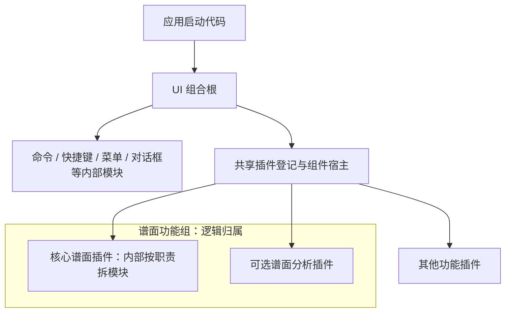

# 插件设计与编写原则 v0.1（评审草案）

日期：2026-10-03。

2026-10-07 实施状态：共同身份/精确 API、UI 承载解耦已落地。备份工作区使用正式 PluginPlatform，
新包为 apiVersion 4.0 + UI facet v1；旧 3.0 React 合同保持兼容。当前可执行合同见
[挂载包说明](./plugin-mount-contract-v4.md)，本文中尚未开放的扩展仍属于设计候选。
核心谱面已经挂载共享五线谱只读 fixture，真实文档编辑未接通；不再是静态中央图片。

2026-10-05 实施补充：副本运行时将工作区布局以 `frame.layout` 独立登记，使用当前 v1 作者适配器和三个宿主受限只读端口；旧组合仅服务历史夹具。新版共同身份、版本/兼容声明及最大可选贡献接口仍是目标合同。接口和实施范围见 [工作区布局小插件](./workspace-layout-plugin-interface.md)。

2026-10-03 作者就绪审查：补充第 11 节的阅读路径、接口开放门槛和交付要求；当前作者文档补齐可执行接入示例与字段／失败合同。

2026-10-04 文档收敛：将“最小贡献”统一说明为“共同基础声明”，保留原术语的语义对应；补充 [受限试点作者规范](./plugin-authoring-baseline-v0.1.md)，并把本产品视觉约定归入 [UI 接入要求](./plugin-product-ui-profile.md)。本次未开放新运行接口，也未制作测试插件。

本文记录第一版插件设计思路，供评审及后续插件策略讨论使用。当前落点是备份框架 `design/frame-visual` 中的 UI 内部插件机制；其中关于职责、接口、状态和生命周期的原则，也可供外部插件平台参考。

本文中的拆分规则是设计建议；第 7 节补入本会话确认的统一贡献要求：所有插件共同的最小必填声明、按需组合的最大可选扩展、范围与程度限制，以及空值处理。它们是下一版合同的设计依据，具体字段名、协议版本和各接口数值上限仍待工程评审。

当前可执行 API 以实际实现及 [插件编写文档](./plugin-authoring.md) 为准。共同声明和扩展矩阵的文档补充未修改校验或 SDK；随后工作区布局的 v1 独立登记已落入副本运行代码。应用级身份、授权与固定会话遵循 [平台目标架构](../../docs/plugin-platform-ui-contribution-and-session-freeze-plan-v1.md)；UI 包内的扩展使用同一平台边界，不另建插件平台。

作者使用本文确认职责、共同声明和可选扩展边界，再按作者文档的当前字段与完整接入示例实施。本文中的候选接口表与语义例用于设计评审；接口是否可用，要同时满足公开合同和当前宿主消费两个条件，不能仅以“声明被接受”为依据。

## 1. 我们希望解决什么问题

让功能可以独立维护、按需替换，同时让运行时的身份、权限、状态和释放关系保持清楚。

基本选择是：**先按职责拆模块；存在独立装配或替换需求，且接口与生命周期清楚时，再成为独立插件。** 插件数量不作为模块化程度的衡量指标。

UI 包内允许包含没有视觉界面的功能插件。同一插件可以同时贡献功能、输入、绘制、动画、设置、菜单和快捷键；按实际需求选择接口，不按这些能力给整个插件分类。

谱面接入建议为：**一个逻辑上的谱面功能组，首版拟由一个核心谱面插件及其内部模块实现；后续符合条件的辅助功能作为平级插件登记。** 当前中央仍为静态示意，真实谱面插件尚未接入。功能组只表达归属，不引入父插件管理子插件的运行层。

## 2. 统一术语

| 名称 | 含义 | 是否单独登记为插件 |
| --- | --- | --- |
| UI 插件包 | 提供 UI 宿主、内部机制和功能插件接入方式的代码包 | 包本身不等于一份功能插件声明 |
| 包内模块 | 命令路由、快捷键映射、菜单绑定、组件宿主等有明确职责的实现模块 | 通常由组合根直接装配 |
| 功能插件 | 具有稳定身份，通过公开合同贡献功能的独立登记单元 | 是 |
| UI 贡献 | 插件提供的面板、中央视图或槽位内容 | 随所属插件登记；一份插件可以贡献多个 UI 单元 |
| 内部功能模块 | 插件内部的绘制、定位、选择、输入适配等实现 | 随所属插件初始化和释放 |
| 功能组 | 文档、目录或装配清单中的相关功能集合 | 分组本身不登记 |

讨论时可以把可插入的功能称为“小插件”，但在编写文档和 API 中要注明它是内部模块、UI 贡献，还是独立登记的功能插件。一个按钮、一个文件或一个 UI 组件，并不自动对应一个独立插件。

代码包、发布包、登记单元和功能组也不必一一对应；它们的正式映射留给后续详细插件策略。

上表区分的是组织层级和登记关系。“功能插件”是独立登记单元的描述，不要求新增插件类型字段。`panel/view/slotItem` 是单项 UI 贡献的合同种类；平台的 `system/product/third-party` 是信任与装配角色，继续约束权限上限。两者都不要求插件在功能、视觉或动画之间选择一种类别。

## 3. 可供内外部插件机制共用的原则

### 3.1 职责和接口先于目录拆分

先说明功能完成什么、接收什么、产出什么，以及依赖哪些能力，再决定如何组织文件和登记单元。能够拆成多个文件，只证明代码可以模块化。

协作使用公开的受限接口，例如只读快照、订阅、已获准命令和明确的领域端口。插件不通过另一个插件的私有对象、DOM 结构或内部函数取得隐含能力。

### 3.2 每份共享状态有明确所有者

文档、布局、配置和功能私有状态分别确定写入负责人。其他消费者读取投影，修改时通过负责人提供的入口。

局部缓存、绘制数据和临时预览可以存在，但要说明失效方式及提交边界，不能成为第二份可独立提交的真实文档。

### 3.3 身份与呈现分开

插件和贡献的稳定身份不随标题、图标、位置或视觉样式变化。用户改变布局，不应改变组件所属插件、命令目标或业务数据归属。

名称中的“核心”表示产品的重要性及默认装配意图，不授予额外权限，也不意味着它必须管理其他插件。

### 3.4 生命周期和失败行为明确

说明谁初始化、谁最终释放，以及初始化中途失败如何清理已经取得的资源。订阅、事件、定时器和私有样式应随所属实例清理，重复释放应安全。

失败策略由应用场景决定：关键插件失败可以阻止启动，可选功能失败可以局部降级。独立插件不等于任何失败都必须被忽略；故障隔离也不等于进程或安全隔离。

### 3.5 抽象随真实需求增加

复用宿主已有的登记、命令和生命周期机制。发现具体协作需求后再补接口，避免仅为功能分组建立第二套管理器或通用依赖容器。

这些原则可用于外部平台，但 UI 的 DOM、焦点、槽位和布局规则不直接成为外部平台通用合同。外部执行环境、权限隔离和兼容策略需要单独设计。

### 3.6 最高视觉原则：关键内容用文字，其余优先图形

插件或宿主的常态界面只使用必要文字。文档、谱面、状态、错误原因、确认动作和无法由图形推断的业务名称属于关键内容，可以直接显示；能够由图标、形状、位置或状态表达的操作，不应再用密集说明句占据布局。

图形入口必须保留清晰的可访问名称，并通过 tooltip、帮助浮层或辅助技术提供用户主动请求的说明。说明文字不能因为视觉上隐藏就从无障碍树中消失；同样，也不能把无障碍名称或 tooltip 直接渲染成常态布局中的长句。

新增任何界面文字前，作者必须回答“这是用户完成当前任务所必需的关键内容吗？”如果答案是否定的，应改用图形入口、状态反馈或用户主动展开的帮助。该原则优先于插件自己的局部排版偏好，并适用于内部 UI 小插件和外部插件贡献。

## 4. 什么时候应该成为独立插件

候选功能应同时回答清楚以下三个问题。

| 条件 | 需要说明的内容 | 尚不满足时的处理 |
| --- | --- | --- |
| 有实际独立需求 | 为什么需要单独装配、替换或复用？具体使用场景是什么？ | 先作为所属插件的内部模块 |
| 有清晰协作接口 | 输入、输出、共享状态所有者、命令权限是什么？能否避免依赖他人的私有实现？ | 先收敛接口，不急于独立登记 |
| 生命周期能够分开 | 单独启动、缺失、初始化失败和释放时，依赖者会怎样？谁负责资源？ | 保留共同生命周期，或先明确必要依赖 |

独立并不要求完全没有依赖，也不要求用户一定能关闭它。默认必需的核心插件同样可以独立登记；关键是依赖可说明、缺失行为可验证。

通过上述判断后，再检查拆分收益是否超过新增的接口、权限、装配和状态协调成本。评审至少提供一条独立接入流程，以及一个依赖缺失或资源释放的验证场景。

以下理由本身不足以成立：代码文件很长、功能重要、多人分别开发、想减少目录嵌套、预计以后可能有很多扩展。这些情况首先可以通过模块边界解决。

如果拆开后需要双方不断同步选择对象、光标、视口和绘制阶段，或通过相互读取内部对象才能工作，应重新检查边界。把这部分保留为内部模块，并不会妨碍以后在接口稳定时再拆分。

## 5. UI 内部机制的组织方式

下图表示设计方向。谱面部分尚待实现；图中的功能分组只用于表达归属。



独立功能插件由同一宿主平级登记。一个插件内部可以有多个模块和多个 UI 贡献；这些模块由所属插件装配和清理。功能组不替它们登记、不承担转发，也不创建额外路由器。

UI 命令路由器、快捷键路由器、菜单和对话框是包内模块。当前组合根在每个 UI 运行实例中统一装配它们，各功能插件共用相应入口。未来出现明确的替换需求时可以调整内部接口，第一版不将这些基础机制分别注册成平台插件。

### 5.1 命令和输入的边界

功能插件可以贡献自己的 UI 命令。按钮、菜单和离散快捷键引用同一个动作实现，避免为每个入口复制业务逻辑。

```text
按钮 / 菜单 / 离散快捷键
  → 共享 UI 命令路由器
  → 所属命令处理函数
  → 必要的类型化领域端口 / 应用服务
  → 内核事务
  → 只读投影与界面反馈
```

UI 命令表达界面动作，内核事务表达业务修改。两者可以存在语义转换；这不要求再建立一个在插件间逐层转发的命令体系。一次用户编辑应产生一次预期提交，错误、过期请求和重复请求的处理也要在接口中明确。

该链路是业务接入目标，当前备份入口尚未接入真实内核。连续指针移动、拖拽预览等交互不必全部注册为命令；需要时可使用获准的类型化端口，提交时仍由业务状态所有者处理。

### 5.2 UI 内容与视觉布局的边界

规范贡献类型为 `panel`、`view`、`slotItem`。类型表达内容职责，具体承载能力由宿主提供；接受声明不等于当前入口已经能呈现所有类型。

中央谱面工作区同样是可供插件声明的承载区域，主谱面视图是其中的一项内容。目标设计允许获准的辅助面板和工具在工作区内部左右两侧分别占位，固定内容不遮挡谱面；右键菜单等小面积内容可临时悬浮。内容形态、允许区域及区域内位置分别表达。当前 panel 仅左右侧栏、view 仅 stage 的限制继续如实记录，待合同与宿主承载一起升级。位置、坐标参照、布局配置及输入边界见 [工作区位置设计](./score-workspace-placement.md)。

用户已确认首版先提供主体及工作区左右固定预设位置，后续增加自由放置。固定组件的承载配置属于布局编辑；临时浮层由宿主按触发点或公开锚点定位，日常可用，不保存为自由布局坐标。谱面浏览和业务操作继续按各自交互合同执行。

工作区两侧插件区与原左右侧栏分别表达。放大时宿主协调原左右侧栏收起让空间；退出放大或空间恢复后按侧、按属性恢复，保留期间的手动开关和尺寸调整。该策略由原状态所有者管理，插件不直接写全局布局；临时菜单复用原命令和权限。触发定义、空间阈值及防振荡验证留工程合同，当前代码尚未实现自动收放。

[宿主接入合同草案](./workspace-host-contract-v0.1.md) 进一步约束有效的区域／位置组合、跨区域单一编排所有者、阅读视口、手动意图与临时菜单来源。沿用原目录、组件实例、编辑会话及命令执行链；正式字段与实际宿主能力仍需工程交付，不能仅凭草案开始依赖新接口。

上／下／左／右四栏是通用区域。开关、尺寸和几何排布随时可用；编辑模式管理栏内组件配置。左右侧栏的预制样式及用户选择功能留到后续，组件身份不固定绑定某种页签、列表或网格外观。

布局取消只处理约定的组件配置，谱面业务撤销由业务会话／内核处理。组件输入、业务选择和阅读状态不作为布局回滚数据。

框架负责入口槽位、区域几何、命中范围、当前状态与焦点反馈；插件负责自己的图标图形、内部按钮、配色和内容排版。主题变量及基础皮肤供插件自愿采用。谱页稳定、窗口居中、边缘和滚动条等本产品要求集中维护于 [UI 接入要求](./plugin-product-ui-profile.md)，不作为所有外部平台通用的插件规则。

## 6. 谱面功能的第一版划分

以下是推荐接入方案，不是已经登记或实现的谱面插件清单。

| 内容 | 推荐归属 | 所有权及协作边界 |
| --- | --- | --- |
| 谱面绘制、元素定位 | 核心谱面插件的内部模块 | 消费真实文档投影，并与宿主明确视口和坐标接口 |
| 选择、光标、输入解释 | 核心谱面插件的内部模块 | 首版由核心谱面插件明确统一负责人，避免多个模块各保存一份权威选择 |
| 编辑意图及命令适配 | 核心谱面插件的内部模块 | 将 UI 意图提交给获准的领域端口，不实现音乐规则 |
| 真实谱面文档、版本、音乐规则、事务及撤销 | 应用服务／内核 | UI 读取投影；界面缓存不替代真实状态 |
| 谱面分析、检查等辅助面板 | 符合第 4 节条件时成为平级插件 | 消费公开投影；需要定位或编辑时使用明确的协作接口 |

未来需要跨视图共享选择时，应先明确统一会话及其公开端口，再调整所有权。不要先让多个插件各自维护选择状态，随后靠广播不断修补同步。

当前局部和谱面快捷键必须绑定所属插件自己的组件，谱面作用域还要求该组件具有视图身份。因此，首版不直接把谱面输入拆成接管另一插件视图的独立插件。后续有真实替换需求时，先设计受限的输入协作接口及对应权限规则。

推进顺序建议为：真实只读谱面 → 选择与光标 → 单个音符编辑及投影反馈 → 撤销／重做及拒绝场景 → 根据实际需求提取辅助插件。核心功能可由不同人员分别维护内部模块，无需为分工增加登记单元。

这里的谱面编辑会话与现有栏内配置编辑会话是不同概念，分别管理业务编辑和布局配置。

## 7. 插件作者应写清楚什么

作者先按第 4 节判断登记粒度。**共同基础声明是所有插件共同必备的元数据；可选贡献集合是框架允许在此基础上组合的扩展。** 前者对应此前讨论及平台目标文档中的“最小贡献”，后者对应“最大贡献”；语义保持，不要求插件必须产生视觉内容，也不要求填满扩展接口。

### 7.1 共同基础声明（原称最小贡献）

下一版合同统一要求下列语义；正式键名和嵌套结构由统一 SDK 评审确定，不直接把这些字段加入当前 `defineUiPlugin`。

| 共同必填项 | 含义及校验要求 |
| --- | --- |
| 稳定身份 | 唯一、非空、格式合法的插件标识；沿用平台身份与命名空间映射，不制造第二个所有者身份 |
| 名称 | 非空、非纯空白的可读名称；用于识别插件，不自动生成面板、按钮或图标 |
| 插件版本 | 按选定版本规范可解析的实现版本；用于识别安装与恢复的具体实现，不与宿主 API 版本混用 |
| 宿主接口兼容要求 | 对已发布宿主接口版本或兼容范围的明确要求；格式合法且当前宿主满足要求，不能用空值表示兼容一切 |

身份与贡献所有者由宿主在登记时绑定；插件不能通过贡献条目自报另一个 `ownerPluginId` 冒领身份。平台已有的等级、激活和执行域合同继续生效，其配置来源与最终授权由可信宿主决定；这里的共同集合不删减既有平台必填项。

图标、面板、功能动作、动画、设置、快捷键、依赖和生命周期钩子不强制属于所有插件的共同集合。选择某个扩展后，它的内部必填项才成为该条目的要求；创建订阅、定时器、绘制或其他资源时，必须有可验证的释放路径。

**基础声明合法且全部可选贡献为空，是合法的最小插件声明。** 宿主不强制它至少提供一项功能，不为它生成虚假入口或占位。声明是否合法与插件是否实现其承诺的功能分别验证；如果会话必需的某个接口没有提供者，仍按依赖策略拒绝启动，不能用“空声明合法”掩盖该缺失。

### 7.2 可选贡献集合（原称最大贡献）

可选贡献集合表示宿主开放的能力上限，不表示插件默认拥有全部权限。实际能力是插件声明请求、宿主开放接口、平台权限上限和本次会话授权的交集。接口有各自的条目合同，插件使用一个作者入口组合它们；宿主不按插件名称写特判。

下表是可选扩展的设计边界。候选接口需先完成合同、权限、失败及验证规则，再对作者开放；列入本表不代表当前已经实现。

| 可选接口 | 可贡献的内容与范围限制 | 必须规定的程度或冲突限制 |
| --- | --- | --- |
| UI 内容与入口 | 面板、主体视图、槽位内容；目标区域包括四栏和谱面工作区，实际允许区域及区域内位置依合同校验；沿用稳定贡献身份与组件实例 | 可承载数量、位置参照、尺寸、冲突、溢出及不可用反馈；本产品工作区左右固定内容独立占位、不遮挡谱面，固定会话和当前单实例约束继续生效 |
| 临时浮层 | 获准的小面积菜单等内容，经宿主按触发点或公开锚点定位，复用原动作与权限；不作为新的插件类别 | 面积与内容容量、边界、层次、输入保护、关闭及焦点返回、锚点失效和资源清理；不保存临时布局坐标 |
| 功能、查询与编辑适配 | 具有明确输入输出的功能，使用获准的类型化领域端口；写入由权威状态所有者处理 | 请求范围、数据量、频率、耗时与并发；版本、取消及重复请求语义由端口约定 |
| 输入行为 | 作用于获准组件或明确输入目标的处理器；声明认领、交还和优先关系 | 作用域、保留输入、输入法与文本输入保护；一次输入只认领一次，不用加载顺序覆盖 |
| 绘制与装饰 | 在获准容器或图层消费只读状态；明确坐标系与刷新入口，不直接改变谱页或宿主几何 | 图层与对象数量、更新频率、耗时及资源；独占目标须选择提供者或报冲突 |
| 动画与效果 | 自身或明确获准目标上的表现；声明触发、静态回退、停止与取消 | 时长、重复、并发、快速更新和隐藏策略；遵守关闭／减少动效，旧效果不能覆盖最新状态 |
| 命令、菜单与快捷键 | 复用原 UI 命令执行链；菜单使用批准入口，快捷键使用获准作用域 | 条目数量、菜单层级与文本容量、保留键位与冲突诊断；不隐式覆盖宿主核心动作 |
| 设置与配置 | 自己命名空间内的配置结构、默认值、校验及必要设置界面；明确保存责任 | 字段数量、层级、值域、存储与迁移；业务配置不混入布局配置，不读写其他插件私有设置 |
| 事件与状态订阅 | 有实际协作需要时提供明确主题、载荷和只读订阅；状态仍由一个所有者写入 | 载荷大小、发布频率、订阅数量及清理；不为此新增任意全局事件总线 |
| 状态反馈与恢复入口 | 通过宿主绑定来源的报告合同提供结果、进度及问题；呈现消费稳定投影，恢复引用已有获准动作；报告方不绑定具体通知或错误界面 | 所有权、目标、更新次序、重复报告、记录容量及保留；未知错误码有基础表达，呈现可替换且失效有最小可见回退；详见[反馈扩展边界](./feedback-extension-boundary.md)，当前端口尚未开放 |
| 私有任务与资源 | 为所选贡献申请宿主允许的异步工作、计时及资源；随所属实例登记清理 | 任务并发、生命周期、暂停／取消、资源预算和失败反馈；隐藏不会自动释放任意作者任务 |
| 样式与呈现方案 | 自身内容样式或明确开放的宿主呈现扩展；宿主持有布局，插件保留内部视觉特色 | 目标选择器、方案参数、容量和替换规则；不覆盖宿主控件、其他插件子树或权威布局状态 |

功能接口不会重新形成一个 UI／Agent 共用的全局 `operations` 目录或通用业务 Gateway。UI 命令路由器、焦点、布局和生命周期模块继续由既有组合根装配；扩展通过明确端口协作。

反馈解耦边界从现在定义，不等到新增插件或替换呈现时再补。默认提供者即使由组合根内部装配，也必须按报告／消费合同协作；满足独立装配或替换需求时可以登记为平级插件，仍不按错误／通知等功能分类。业务拒绝、事务及恢复条件归状态所有者，呈现不直接执行或自动重试业务。新版接口、旧notify适配及“新增插件／替换提供者无需改既有插件”的验收集中在[反馈扩展边界](./feedback-extension-boundary.md)，不作为当前SDK已开放能力。

UI故障、内核结果及其他插件问题的流向与前期影响集中在[跨层反馈审查](./feedback-cross-layer-review.md)：UI问题交所属宿主，业务结果经原服务边界返回，恢复经原获准执行链；诊断留存和反馈呈现分别处理。传输故障有结局待核对状态，不把所有异常当成事务拒绝。共同基础声明不增加强制错误钩子或内核依赖，正式接线仍由工程定版。

### 7.3 范围与程度如何执行

**范围限制**回答能作用在哪里、读写什么、调用哪些端口和替换哪些行为。贡献某个面板不自动取得中央绘制权；能读取状态不等于能执行修改；请求动画也不授予布局写入权。替换公共行为必须是接口显式开放的操作。

**程度限制**回答在允许范围内可以贡献多少、嵌套多深、更新多快、运行多久、并发多少和消耗多少资源。按接口及宿主容量制定，不编造所有插件通用的数值上限。每个对外接口必须列出适用维度、宿主默认策略、可配置范围和执行方式；不适用的维度也应明确说明。尚无可执行限制策略的候选接口保持未开放。

声明期检查目标、结构、引用、冲突和可静态判断的限制；运行期检查动态频率、并发、时长及资源。超范围或超限要返回可定位的诊断，明确是拒绝本次请求、取消旧任务、合并更新还是按已声明基线降级。排队、截断或合并只在接口预先规定时使用，不静默丢弃贡献。

每项限制还应注明其执行依据：可强制的硬限制、需要任务配合的取消／预算，或仅用于诊断的观察指标。当前同一主线程中的任意同步作者代码，不能靠计时器承诺强制中断；强隔离及硬资源预算要由相应执行环境合同提供。具体试点按 [作者规范](./plugin-authoring-baseline-v0.1.md) 记录已有强制检查与尚未覆盖的容量边界。

合并型接口说明顺序与组合规则，独占型接口说明唯一提供者及选择机制。贡献声明与授权在启动时进入固定会话；日常设置和展示状态可以更新，但不借此增添贡献拓扑、加载新代码或扩大权限。当前目标是接口组合，保留既有单一平台和状态所有者。

### 7.4 空值、无效与失败的统一规则

作者输入边界先校验共同基础声明，再规范化可选空值并校验所有实际条目。消费端取得规范化结果，不重复猜测 `null/undefined` 的含义。

| 输入或状态 | 目标处理 |
| --- | --- |
| 基础声明整体缺失、`null` 或非对象 | 拒绝登记，报告基础声明错误 |
| 共同必填缺失、`undefined`、`null`，必填文字为空或纯空白 | 拒绝登记并指出字段；不生成默认身份、名称或版本来掩盖问题 |
| 必填类型／格式错误、身份重复、兼容要求不成立 | 明确校验失败，不进入运行集合 |
| 可选贡献集合省略、`undefined` 或 `null` | 统一规范成空数组／空贡献组；不登记、不挂载、不显示占位 |
| 可选集合为合法空数组／空贡献组 | 合法；基础声明有效时允许所有可选贡献同时为空 |
| 可选单项或钩子省略、`undefined` 或 `null` | 按该接口规范为 absence；宿主不调用，或使用合同规定的内部 no-op／静态回退 |
| 已提供集合类型错误，数组含 `null/undefined` 条目或空洞，实际条目缺少内部必填 | 无效声明，指出贡献及字段；不静默过滤为“没有贡献” |
| 已提供钩子不是函数，未知字段、非法目标或越权 | 明确拒绝；未来协议字段通过版本处理，不以空值兼容吞掉未知内容 |
| 合法 `false` 或 `0` | 依字段语义保留；是否超出值域另行校验，不用真值判断当作空 |
| 必需依赖／接口缺失或版本不兼容 | 启动校验失败或明确不可用，按宿主一致性策略处理；不伪装成合法空贡献 |
| 可选依赖缺失 | 仅按已声明依赖及回退规则使相关可选贡献不可用，并给出原因 |
| 贡献已存在但执行异常、超限或返回非法结果 | 保留明确失败与原因；按合同隔离／回滚／降级，不能把异常吞成 `null` 后报告成功 |

未提供、暂不可用、无效声明和执行失败是不同状态。可选效果可以降级的前提是依赖与状态隔离成立；必需功能的失败继续遵守宿主启动或事务规则。可见界面使用明确的空态或原因文字，不显示程序值字符串 `null/undefined`。

当前 `defineUiPlugin` 的空值合同与以上目标不同，见第 8 节。迁移要选定新合同版本或明确兼容适配，覆盖旧输入和空值用例；文档补充不等于旧校验已经改变。

### 7.5 动画与光标的组合例

动画可以与功能同属一份插件，也可以通过明确接口由其他插件提供；无需为添加效果先创建另一种插件类别。宿主持有目标许可、关闭／减少动效、冲突和最终取消策略，作者负责具体表现及资源释放。

功能状态同步成立，绘制消费状态，效果消费变化；动画结束不是业务成功条件，也不是第二份光标状态或音乐时钟。没有动画时使用即时／静态表现；快速更新时旧效果不能写回或覆盖最新状态。当前备份框架默认无动画，本次只补未来贡献合同。

以下为语义示例，不是可以传入当前作者 API 的新增字段：

```text
合法最小插件：
  稳定身份 = example.identity
  名称 = 示例插件
  插件版本 = 合法的实现版本
  宿主接口兼容要求 = 当前宿主满足的已发布接口版本或范围
  全部可选贡献 = 空
  结果 = 声明合法，不产生 UI 占位或默认功能
```

对于一个符合独立登记条件的光标插件：

| 部分或情况 | 合同含义 |
| --- | --- |
| 共同基础声明 | 与所有插件相同：稳定身份、名称、插件版本、宿主接口兼容要求 |
| 按需扩展 | 光标行为与状态接口、绘制、闪烁／移动效果、配置、命令、菜单、快捷键或状态订阅；全部来自第 7.2 节开放接口 |
| 状态所有者 | 光标逻辑位置与选择有唯一负责人，其他消费者读取明确投影；依赖优先指向接口及版本 |
| 动画、菜单或快捷键为空 | 不注册对应能力；已提供的光标功能继续按自身合同工作 |
| 绘制或其他必需依赖缺失 | 明确不可用；不能把“光标无法显示”转成空值后声称功能正常 |
| 越界动画或绘制 | 拒绝越权目标；不移动谱页、不写宿主布局、不绕过输入与焦点分配 |

这里的光标位置更新行为属于该插件按需选择的扩展，不是所有插件共同的基础声明。首版谱面仍可按第 6 节把光标保留为内部模块；将其独立登记需满足第 4 节条件。本会话不实现具体光标或业务插件。

### 7.6 作者说明与工程验收

使用 [当前作者合同](./plugin-authoring.md) 编写现有声明，并在功能说明或设计文档记录：

```text
功能与使用场景：
为何需要独立登记，而非内部模块：
共同基础声明与兼容要求（目标合同；当前 API 按已支持字段填写）：
按需提供的贡献接口与未提供时的行为：
作用目标、权限、替换范围及适用的程度限制：
依赖的公开能力及必要／可选关系：
状态所有者、读取方式和写入入口：
初始化、失败及资源释放责任：
缺失依赖、隐藏、取消、超限及旧请求完成时的行为：
验证场景：合法最小声明、正常组合、关键拒绝／失败与资源清理：
```

这份清单是作者说明，不是新增 manifest 字段。功能组也暂由目录、文档或应用装配清单表达；当前作者根声明没有 `group` 字段。菜单项已有的 `group` 只用于菜单分组。

编写时还应遵守：

- 普通组件使用受限 `ctx` 及明确授予的只读或领域端口，不接收完整 router、布局 store 或任意服务定位器。
- 权限按实际动作声明；读到命令状态或数据，不等于取得执行权限。
- 组件只管理自己的内容和资源；宿主持有承载区域、布局与组件实例关系。
- 通过 `onDispose` 等既有机制及时登记清理，不依赖正常退出才释放资源。
- 声明中不写当前合同不支持的依赖、分组或生命周期字段；确有需要时先讨论合同扩展。

新版合同及其适配至少验证：逐个必填缺失／空白／空值／格式错误；全部可选贡献省略、`null` 和空集合；合法 `false/0`；非法条目与钩子；纯功能及功能／动画组合；独占冲突、越权、超限；必需与可选依赖缺失；动画关闭／取消／隐藏；安装失败回滚、重复释放与旧协议兼容。文档更新本身不算这些运行验收已经通过。

## 8. 当前事实与后续建议分开

| 项目 | 当前事实 | 本稿方向或尚待完成的内容 |
| --- | --- | --- |
| UI 运行入口 | `createWorkspaceRuntime({ root, plugins, requiredViewSlots })` 统一装配，固定启动集合，应用可声明必需 view 槽位并保留内置内容 | 正式包发布及 SDK 收口 |
| 作者声明 | `defineUiPlugin` 根字段为 `namespace/ui/commands/menuItems/shortcuts`；尚无根级名称、插件版本与宿主接口兼容要求 | 第 7.1 节共同必填的语义已明确；正式字段映射与新版／兼容协议待工程评审 |
| 可选贡献空值 | `ui` 必须是数组，可为 `[]`；其余三组可省略，显式 `null` 均不符合当前校验 | 第 7.4 节允许可选贡献空值；需实现规范化与版本兼容，不能直接视为现有行为 |
| 多种能力组合 | 一份声明可同时提供 UI、命令、菜单和快捷键；单项 kind 不是插件类别 | 功能、输入、绘制、动画、设置等候选接口的统一声明和按接口限制尚待落地 |
| 命令结果与失败 | execute返回handler结果或Promise，未统一捕获执行异常或校验结果；同步空返回按旧兼容规则视为成功 | 新作者显式约定结果，调用方处理失败和异常；不能把第 7.4 节的目标失败规则视为已全面实现 |
| 内部登记 | 作者适配器仍生成既有 v1 登记协议 | 历史内部名称不决定新功能布局 |
| 内容承载 | 作者合同和目录有三种规范类型；当前入口实际消费侧栏 `panel` | 中央 `view`、工作区左右固定内容、小面积临时浮层及上下栏 `slotItem` 的合同与真实消费；自动收放与手动调整保留需宿主实现 |
| 插件生命周期 | 固定集合安装、失败记录、回滚和统一释放；当前应用入口要求整个启动集合成功 | 不承诺运行中安装／卸载或可选启动降级 |
| 内容加入／移出 | 修改已加载组件的编排及启用状态 | 不等于安装／卸载插件，也不等于新增组件实例 |
| 真实谱面 | 当前中央仍是静态谱面示意 | 核心谱面插件、真实服务及编辑闭环 |
| 功能组 | 本稿提出逻辑分组方式 | 没有新增父插件、分组注册或依赖解析机制 |
| 外部插件平台 | 平台目标文档规定统一身份、授权与固定会话；本文从 UI 包内组合需求补充契约 | 按平台已有身份与所有权接入，不以 UI 包内扩展再建另一套平台 |

## 9. 留给后续详细插件策略的事项

后续规划需要单独决定：

- 共同基础声明在既有平台身份与 UI 作者输入之间的正式字段映射、协议版本和兼容迁移。
- 第 7.2 节各候选接口的公开形状、范围、默认限制、实测数值上限、冲突及超限处理；逐项开放而非一次全部实现。
- 可选空值的统一规范化、非法条目的字段诊断，以及必需失败和可选降级的宿主一致性政策。
- 代码包、发布包、插件登记单元及功能组如何对应，是否需要用户可见的组管理。
- 必要与可选依赖、版本兼容及缺失依赖如何声明和诊断。
- 插件之间是否需要新增能力接口，以及这些接口的所有权和权限规则。
- 用户安装、启用、停用、更新和配置迁移采用什么策略。
- 第三方代码的执行环境、权限隔离、发布校验和错误报告采用什么方案。

这些事项不由本稿提前指定实现。共同最小声明、无功能分类、最大可选扩展及空值边界作为需求依据；字段名、数值与实现批次继续评审。具体外部组件、真实谱面和正式协议由对应工程会话实施，本会话维护框架视觉与承载要求。

## 10. 相关文档

- [插件编写与当前接口](./plugin-authoring.md)：声明、权限、贡献、组件上下文及当前限制。
- [UI 包内部模块与统一装配入口](./runtime-composition.md)：已实现的职责、状态所有权、启动和释放。
- [UI 插件框架后续规划](./ui-plugin-roadmap.md)：已完成批次及后续接入安排。
- [应用级插件平台目标架构](../../docs/plugin-platform-ui-contribution-and-session-freeze-plan-v1.md)：单一平台、类型化领域端口、授权与固定会话。
- [受限试点作者规范](./plugin-authoring-baseline-v0.1.md)：已开放能力、作者结果约定、兼容边界及从文档到测试插件的门槛。
- [本产品 UI 接入要求](./plugin-product-ui-profile.md)：当前视觉与布局约定，不混入外部平台通用原则。
- [谱面工作区位置与承载](./score-workspace-placement.md)：区域与内容分离、工作区辅助内容、位置参照及接入门槛。
- [插件反馈与可替换呈现](./feedback-extension-boundary.md)：报告／消费合同、提供者替换、旧接口迁移及未来新增插件的验收。

本稿集中维护插件划分原则与 UI 包内统一贡献的目标契约；作者文档维护当前可执行 API，路线文档维护实施状态。评审后将稳定字段与规则纳入正式作者规范，待定策略继续保留讨论状态。

## 11. 作者落地路径与接口就绪门槛

### 11.1 能否仅凭本稿稳定编写

本文能够约束设计方向，但其候选接口、未定字段和语义例不足以单独构成完整开发合同。当前已支持的内容应以 [作者文档](./plugin-authoring.md) 的字段表、完整声明／启动／测试页示例和失败路径实施；需要菜单、键位或确认时再读取对应专项合同。新增接口要达到第 11.2 节门槛后才供作者使用。

准备首批测试插件时，先使用 [受限试点作者规范](./plugin-authoring-baseline-v0.1.md) 的开放范围及 D/H/P/B 门槛。当前阶段先收敛文档，再制作代表性插件；基础试点通过不自动开放中央视图、共享绘制、驻留任务或真实业务端口。

| 作者需求 | 当前可执行路径 | 就绪判断 |
| --- | --- | --- |
| 无公开贡献的登记单元 | 当前namespace/ui空数组可验证；未来共同四项声明仍待协议迁移 | 旧协议示例可用，不代表新版最小声明已经实现 |
| 没有面板的离散功能 | 在ui空数组之上贡献commands，返回明确结果；使用已获准命令入口 | 当前可用；无插件根级初始化／释放钩子，长期资源与服务、绘制等接口仍需单独开放 |
| 侧栏内容和自有交互 | panel声明、受限ctx、持久实例；菜单／快捷键引用同一个handler | 当前可接入；须验证权限、隐藏／移动／释放和真实视觉容量 |
| 复杂组件键盘交互 | 当前实例的同步handleKeyDown与已声明局部键位 | 当前可用；不能接管另一插件视图或绕过宿主焦点分配 |
| 中央 view、工作区辅助内容及上下 slotItem | 现有中央 view／上下 slotItem 可声明；工作区左右固定承载、临时浮层与自动收放为目标设计 | 当前组合根缺对应真实消费路径；须验证固定内容不遮挡谱面、手动调整保留与浮层输入，不通过放宽 panel 校验宣称完成 |
| 独立功能服务、跨组件输入、共享绘制、动画或设置扩展 | 第 7 节记录目标、权限、依赖与限制 | 统一作者接口尚未开放；记录合同需求，由工程逐项落地 |
| 插件反馈报告、任务更新及可替换呈现 | 当前notify仅有文本记录；扩展边界先设计来源绑定、稳定投影、恢复引用及替换合同 | 当前新增端口未开放；必须验证新增插件与提供者替换不修改既有调用者，不能先依赖具体反馈实现再推迟解耦 |

以上判断按能力及宿主路径说明，不给插件分类。插件组合已开放接口即可；已有内部模块若不需要独立登记，继续由所属插件或组合根按职责装配。

### 11.2 每项公开接口必须交付的合同

接口供作者使用前至少具备下列资料和实现依据：

1. 对应宿主版本与公开入口；输入字段、类型、必填、默认值、允许值及未知字段处理。
2. 空值在集合、单项、条目内部和执行结果上的分别定义；不能用统一真值判断代替合同。
3. 同步或异步要求、返回形状、可预期拒绝及异常传播方式；取消与陈旧结果怎样处理。
4. 目标及读写权限、身份绑定、状态所有者、必要／可选依赖与可用性查询方式。
5. 初始化、首次消费、隐藏、恢复、移动和最终释放的责任；部分失败时谁清理已取得资源。
6. 适用的程度限制、冲突规则、可执行的超限策略与可定位的诊断。
7. 不依赖未定义函数、全局对象或私有入口的接入例；示例从声明到实际宿主消费可重放。
8. 正常、拒绝、失败与释放的验证场景，以及旧协议兼容或迁移安排。

接口合同集中在一处维护，设计稿与路线链接到它。宿主未消费或未验证的条目标记相应状态，不发布成已经可用的SDK能力。例子的身份、布局、CSS或缓存也不成为宿主新增特判。

### 11.3 作者交付与验证

每个独立插件交付实现、合法声明、依赖／权限说明、资源与失败说明，以及使用它的宿主接入验证；有视觉时提供容量、焦点及私有样式检查。功能语义仍由该插件自己的测试证明，共同基础声明不随功能改变。

至少确认：声明能登记；实际目标能够消费；一次输入调用一次预期动作；拒绝或异常有可读反馈；隐藏与跨区域移动保持实例；最终释放后没有旧监听、计时或陈旧回写；新会话没有上一实例的私有状态残留。涉及业务写入时，还要验证类型化端口、版本与事务结果，不能只验证一个mock成功。

当前作者文档的示例核验命令与证据见 [作者就绪审查](./evidence/plugin-authoring-readiness-20261003/review.md)。它验证已有宿主的声明与交互链，DOM替身不证明像素、系统输入或第三方隔离。候选接口和新版共同声明的运行验收继续留给对应工程工作。
