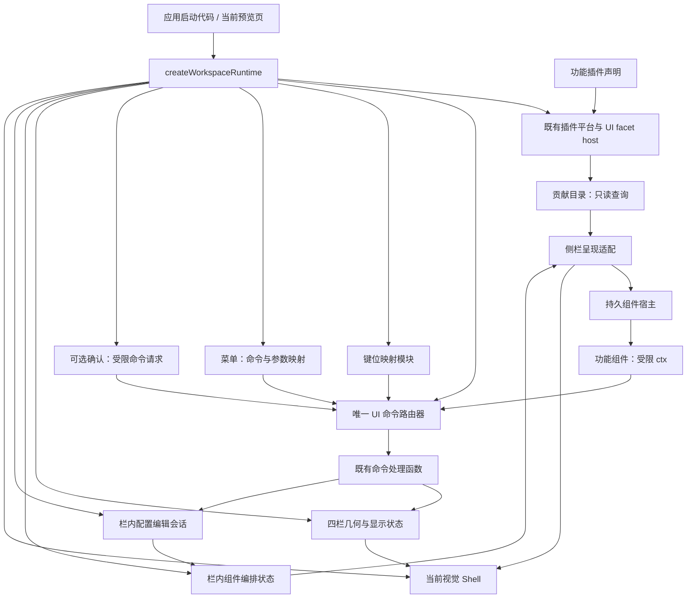

# UI 包内部模块与统一装配入口

2026-10-05 补充：工作区布局已从 `frame.builtin` 的兼容组合中拆出，作为备份运行时的平级 `frame.layout` UI 小插件登记，页面 id 为 `frame.layout.page`。核心谱面只读切片以 `notation.core` 注册，并贡献唯一的 `notation.core.view` stage view。旧 `frame.builtin.layout` 仅保留给历史视觉夹具和基线迁移比较；接口与边界见 [工作区布局 UI 小插件接口](./workspace-layout-plugin-interface.md)。

日期：2026-10-03。实施位置为备份框架 design/frame-visual。本文描述已落地的组合根，不代表正式 SDK 发布、真实内核业务或完整浏览器验收已经完成。

## 三种角色

**应用启动代码**调用 createWorkspaceRuntime。它选择本次固定插件集合，持有运行实例，并负责处理启动/释放异常。

**UI 包内部模块**分别管理命令、键位、菜单、瞬态窗口、组件实例与布局。它们由组合根直接装配，拥有明确的依赖和生命周期，不各自注册成额外平台插件。

**功能插件**通过一份 defineUiPlugin 声明贡献命令、默认快捷键、菜单项和 UI 内容。组件经 ComponentHost 挂载，只收到受限 ctx；它们不会因为能贡献命令而得到全局 router/store。



箭头表示主要依赖或调用关系，不是新增消息总线。动作状态只读投影供菜单、按钮、确认窗口消费，仍从原命令和状态所有者读取。

## 模块职责与状态所有权

| 位置 / 模块 | 唯一职责或状态 | 依赖与边界 |
| --- | --- | --- |
| host/workspace-runtime.js | 本次运行实例的启动、root 所有权和统一释放 | 组合根可以引用功能、内部模块和 Shell；不实现音乐规则 |
| runtime/plugin-installer.js、ui-plugin-host.js | 固定贡献集合、所有权、安装验证与回滚 | 沿用原平台、v1 facet 登记与作者适配器 |
| runtime/command-router.js | 命令定义及单次处理函数调用 | 不知道布局或内核音乐规则 |
| runtime/shortcut-router.js | 默认绑定、内存覆盖、有效键位和冲突 | 键盘模块选定命令后复用原 router/组件权限 |
| runtime/menu-registry.js、host/workspace-menus.js | 菜单声明、参数映射与受限读取/执行 | 不再保存一份业务动作实现 |
| host/action-state-read-port.js | 命令存在、可用、勾选与键位的只读视图 | 不执行、不缓存另一份命令状态 |
| host/command-dialogs.js | 确认请求和组件所属瞬态窗口 | 复用 ctx.execute；不新增插件或 dispatcher |
| runtime/component-host.js | 每个组件的持久 cell、受限 ctx 与资源释放 | 私有输入/阅读/业务状态留在组件；跨侧栏不重挂载 |
| layout/workspace-state.js | 四栏显示、尺寸、几何排布与导航 | 日常随时可用；不进入谱面文档/撤销栈 |
| layout/sidebar-composition-state.js | 栏内组件身份、位置、启用和顺序 | 不保存 DOM 或组件私有状态 |
| layout/layout-edit-session.js | 栏内配置草稿基线、共同确认/取消 | 协调原所有者；不复制一个新的布局 store |
| host/sidebar-presentation.js、stage-viewport.js | 编排投影、cell 移动，以及谱页阅读坐标 | 当前侧栏呈现仍为兼容列表/页签；坐标不进入布局配置 |
| shell/、features/ | 视觉节点和具体功能内容 | 普通功能使用受限 ctx/只读端口；Shell 是可信宿主视图 |

贡献身份、componentId、namespace 与视觉呈现仍分开。legacy surface id 可与 componentId 不同；导航使用贡献 id，实例使用 componentId。新增规范 panel 允许左右侧栏，是否启用、放在哪侧由编排状态决定。四栏名称和样式选择的既定方向保持，预制样式留后续。

## 当前应用入口

```js
import { createWorkspaceRuntime } from "./src/host/workspace-runtime.js";
import { defineUiPlugin } from "./src/runtime/ui-plugin-contract.js";

const plugin = defineUiPlugin({
  namespace: "example.notes",
  commands: [{ id: "example.notes.inspect", run: () => ({ ok: true }) }],
  ui: [{ id: "example.notes.panel", kind: "panel", title: "笔记",
    slots: ["left", "right"], defaultSlot: "right", defaultEnabled: true,
    permissions: { commands: ["example.notes.inspect"] },
    mount(element, ctx) {
      const button = document.createElement("button"); button.textContent = "检查";
      const click = () => ctx.execute("example.notes.inspect");
      button.addEventListener("click", click);
      ctx.onDispose(() => button.removeEventListener("click", click));
      element.append(button);
    },
  }],
});

const runtime = createWorkspaceRuntime({ root: document.getElementById("app"), plugins: [plugin] });
// 可信应用启动代码可以执行已登记命令、订阅只读工作区、结束实例。
runtime.execute("frame.workspace.region.toggle", { region: "left" });
const stop = runtime.workspace.subscribe(snapshot => console.log(snapshot.leftOpen));
stop();
// 页面宿主退出时使用 runtime.dispose()；普通组件不持有 runtime。
```

返回值冻结，只含 execute、workspace.snapshot/subscribe 和 dispose。execute 是可信应用入口，不是普通组件权限；普通组件继续使用 ctx.execute、notify、onDispose、可选 confirm。namespace 只表示稳定身份，不生成 CSS 或决定尺寸。示例只说明接入方式，不加入默认产品内容。

默认 runtime-preview.js 只有导入和启动调用。默认装配 `frame.builtin`、`frame.layout` 和启动时传入的外部插件：前者保留三个普通内置内容，后者提供唯一的工作区布局页面；右栏限制、CSS、尺寸、导航行为和实际命令处理函数仍由现有宿主负责。额外声明只能在启动时传入，作者适配器仍生成既有登记协议，没有推出 v2 manifest。

当前备份预览把 `stage` 作为应用必需 view 槽位：`createWorkspaceRuntime` 接收 `requiredViewSlots: ["stage"]`，在 `catalog` 查询后要求恰好一个 stage view。通用运行时仍允许省略该策略，以便布局和插件平台的独立测试继续运行；这项检查属于应用组合根，不属于 `PluginPlatform` 对某个具体插件的硬编码依赖。

缩放由 `WorkspaceState`、工作区命令和唯一 `StageViewport` 共同拥有。壳层可以放置缩放控件，谱面插件只提供内容边界和绘制结果；缩放不进入栏内布局编辑的确认／取消回滚，也不由 `notation.core` 自己维护第二份视口状态。

## 启动与释放合同

1. 导入 factory 无 DOM 或事件副作用。启动需要当前浏览器 document 内已连接的 root；同一 root 的活跃实例拒绝重复启动。
2. 声明固定集合并安装，检查 platform.start() 的实际记录。任一插件安装失败，本入口回滚整个启动集合并抛出原因；低层平台仍保留既有单插件失败记录策略。不会把半启动应用当成完整成功。
3. 目录/编排/受限端口在组件首次挂载前接通。Shell 创建一次，组件只在需要显示时挂载一次；组件 mount 失败仍局部显示错误，不让整个工作区崩溃。
4. 取得资源时立即登记。Shell 构造尚未返回就失败，也清理已经取得的菜单、缩放、侧栏和壳节点；不清空 root 内应用自己持有的其他节点。
5. 释放先标记实例结束；解绑窗口、键盘、呈现和外部读取订阅，关闭命令确认窗口，再释放视图/组件和注册贡献，最后结束配置会话。菜单或组件私有资源按原所有者清理。
6. 一个清理回调失败，仍执行后续清理；错误以 AggregateError 报告。组件自身清理失败沿用 ComponentHost 的 notice 隔离。重复 dispose 无作用，不重复执行失败回调；root 释放后可重新启动。
7. pagehide.persisted 保留实例用于浏览器页面恢复；普通 pagehide 执行同一 dispose，并移除 pagehide 监听本身。若页面恢复后宿主主动重新创建实例，仍应先释放原实例。
8. 释放后的 execute 返回 runtime.disposed，新 workspace.subscribe 拒绝。旧只读 snapshot 可读取结束时的数据；取消订阅/释放会抑制同轮通知中已复制但尚未调用的回调。已开始的业务命令不会因 UI 消失而自动撤销。

采用原 runtime-support 的 once 清理与 rollback；资源范围是内部所有权工具，不是依赖注入容器、插件管理器或新路由器。

## 验证与实际影响

当前入口测试直接运行生产 factory；故障测试只在测试副本中包装真实构造函数，生产没有测试注入参数。五个历史测试的默认入口观察统一搬到 tests/support/workspace-runtime-test.js，原行为断言保留，快捷键/键盘测试现在也运行实际 StageViewport。

新的测试覆盖三种视口下保存的旧入口 **和旧 Shell** 与新入口的 DOM/属性/状态对照；独立插件的按钮/菜单/局部与全局键位；权限；左右移动/取消的节点/输入/选择/滚动保留；原声明复制、左侧限定、legacy 别名；注册/实际安装/构造/首次呈现/视口/订阅/窗口绑定失败；失败原因与清理异常；重复释放、旧 ctx、通知中释放、BFCache 和同 root 重启。检查实际监听器、状态/菜单/registry 订阅以及贡献残留。

专项 26 项；最终全目录、语法和范围审计的实际结果保存在 evidence/runtime-composition/verification.json。fresh 基线、原稿和 review.diff 一并保存。横向槽位同期修改按独立快照记录，不回滚。历史证据保持原批次含义，不重新运行旧源码审计覆盖。

这批让新工作台可以复用同一个启动入口，功能作者不需要复制菜单/键盘/窗口生命周期。默认 UI 不增加测试面板或改变布局；26 项专项中的视觉部分是 DOM 模型，未计算像素。

## 后续衔接

下一步优先将该入口放入从备份框架建立的最小新桌面运行环境，接真实只读谱面投影，再完成一个音符操作的输入意图→类型化端口→应用服务→内核事务→投影反馈闭环。音乐规则留在内核，离散命令 handler 可薄绑定领域端口，不强制连续输入多绕通用命令层。

当前复用仍在本副本的 ES modules 路径中，没有正式构建/发布 SDK。view/slotItem 的作者声明和目录存在，但这个入口只把 panel 接到当前侧栏呈现；中央视图与上下栏真实槽位消费要在相应批次接入，不能因接受声明就称为完整可用。工作区布局虽已独立登记，仍使用 v1 字段和宿主私有的受限端口，没有热插拔、多窗口、同组件多实例或持久化承诺。

真实浏览器菜单、dialog 模态、焦点、IME 与像素验收仍待可用且获准的环境；既有 file:// 工具拒绝不绕过。DOM 替身和原生方法桩不能代替这些验收。
