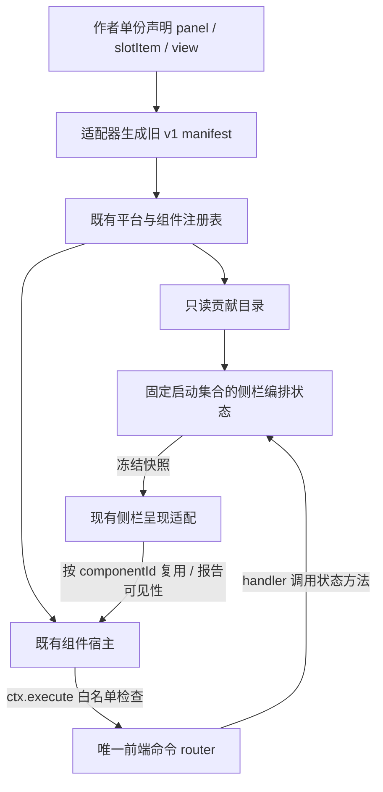

# 统一侧栏内容与编排基础

2026-10-02。合同基础批次的实现与 58 项回归已通过。随后默认 UI 已接入该目录、状态与现有侧栏呈现，当前 70 项回归通过；接入批次说明见 `sidebar-integration.md`，历史证据仍独立保留。

## 所有权与数据流



上图中的呈现适配已经连接默认 Shell，采用当前左侧列表与右侧页签方式。新状态不拥有注册、DOM 或 mount；目录不拥有用户状态；组件宿主不判断页签选择或侧栏几何。左右侧栏是同类承载区域，可选呈现样式仍留待后续。

| 层 | 当前所有权 |
| --- | --- |
| 作者定义 | 稳定 id、名称、图标、允许位置、初始意图、权限、mount |
| 目录 | 从现有 active 安装记录和注册表查询数据描述 |
| 侧栏编排 | 当前区域、启用、区域内顺序 |
| 既有几何服务 | 区域宽高、展开、窗口约束 |
| 当前呈现适配 | 从兼容选择偏好派生页签选择、真实可见性、DOM 排布、样式消费 |
| 组件宿主和实例 | 单组件单实例、私有输入和资源、变化通知、最终释放 |

编排未启用与真实不可见有区别：一个已启用 panel 可能因为未选中页签或侧栏收起而不可见。因此 enabled 是用户编排状态，setVisible 是呈现层计算后报告的实际状态，不能永久等同。

## 状态合同

```js
const state = createSidebarCompositionState({ contributions: catalog.list(), onObserverError });
state.read.snapshot();
// { panels: [{ id, componentId, slot: "left" | "right", enabled, order }] }
const unsubscribe = state.read.subscribe(snapshot => render(snapshot));

state.move(panelId, "right", 0);
state.setEnabled(panelId, false);
state.reorder(panelId, 1);
unsubscribe();
```

仅从启动集合提取编排所需字段，不保留作者对象、样式意图、尺寸、DOM、函数或业务数据。初始化先按作者 order、稳定 id 排序，然后生成区域内从 0 起的连续顺序。order 包含未启用内容，所以隐藏不会自动改变排序。名称、图标和数组顺序都不是身份。

move 可同时改变区域与顺序，只发布一次。index 指移除当前 panel 后目标区域的最终插入位置，范围为 0 到剩余数量；同区域省略 index 保持原位置，跨区域省略 index 追加。reorder 使用同样的最终位置规则。隐藏后仍可移动和排序，恢复时使用当前保存的位置。

允许位置独立捕获并冻结。移动必须属于该 panel 的侧栏能力；不能用用户状态扩大作者授权。重复 panel id、重复 componentId、非法声明直接拒绝创建，避免一个持久实例被两个编排项抢占。旧表面别名仍使用表面 id 编排，通过 componentId 挂载。未来多实例需显式设计 instanceId。

无变化操作返回 `{ ok: true, changed: false }`，保留同一个快照引用且不通知。已接受变更返回 changed true。失败返回 `{ ok: false, code }`，不修改快照或通知：

| code | 含义 |
| --- | --- |
| sidebar.unknown-panel | 不在固定侧栏启动集合 |
| sidebar.invalid-slot | 超出该 panel 允许的侧栏 |
| sidebar.invalid-order | 非整数或超出目标位置范围 |
| sidebar.invalid-payload | 启用值不是布尔值 |

订阅收到冻结的已发布快照，使用该参数渲染。观察者异常被隔离，错误回调异常也不打断其他观察者；重入变更的快照排队，保持所有订阅者收到相同事件顺序。状态没有独立 router，宿主命令 handler 直接调用上述方法。

## 兼容与实例边界

新 panel 只声明 left/right，defaultEnabled 默认 false。旧 module/page 声明与 v1 原生入口仍可安装，样式提示留在旧组件定义里；通用 panel 目录和编排不暴露 full/half、底部高度或样式选择。

旧顶部/底部内容仍可由目录查询。有侧栏能力但默认位于顶部/底部的内容会得到一个未启用的侧栏候选位置，不自动接管旧 chrome 放置；没有侧栏能力的内容完全不进入本状态。slotItem/view 继续归其独立消费者。

移动复用现有 componentId 的持久 DOM 和实例，不能以“换侧栏”为理由 release 后重新 mount。隐藏时呈现层保留已挂载实例，可分离 DOM，再报告 setVisible(false)；恢复时 ensure 取得原元素并报告 true。未启用且从未挂载的内容保持懒挂载。

setVisible 是可选同步实例通知，初始状态 true，重复状态不通知；它不改变 DOM，也不自动暂停业务。实例自行暂停定时器或后台订阅。最终 release、组件定义消失或 host.dispose 才执行资源清理，仍按既有逆序、幂等、异常隔离合同工作。新 hook 不改变组件 ctx 的 execute/notify/onDispose 字段。

## 本批验收证据

58 项相关测试通过。其中侧栏新增 10 项测试覆盖能力投影、双向移动、隐藏与排序、失败原子性、重复身份、别名与窄能力、观察者异常及重入、唯一路由和输入保留、可见性通知失败隔离、非法 hook 回滚。

实际端到端测试连接已有平台、适配器、目录、编排、router 和组件宿主：输入修改后移动左右侧栏再隐藏恢复，mount 次数保持 1；隐藏期间私有资源保留，最终释放清理一次；组件发起一次命令只执行一次 handler。DOM 使用最小测试替身，未将这项测试描述为完整浏览器视觉验收。

本轮 76 个非 evidence 文件有独立起始哈希，六个修改文件有修改前备份。`evidence/sidebar-contract/` 保存本轮范围审计、显式测试输出与语法结果，历史 evidence 不覆盖。原 `design/frame` 的 33 文件清单及 SHA256 另行核对。设计侧同期改动保留并单列。

## 后续接入

首次呈现接入已完成，默认入口消费统一 panel。既有 workspace-state 的 currentPage 暂作右侧选择偏好，实际选择由当前可用列表派生，不再复制一份选择状态；内置包的 v1 格式只在登记层继续兼容。默认 DOM 对照已通过，浏览器截图验收因 file:// 访问被拒绝而未完成。后续继续处理样式边界与业务端口，再提供布局插件可选样式。

本批未完成样式预制与选择、样式专属参数、持久化、热安装卸载、多实例、第三方代码隔离或真实内核连接。CSS 全局后代规则影响插件内部控件的问题仍属于后续样式边界工作，不能仅凭这份内容合同声称全部解耦完成。
