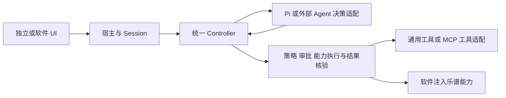

# 独立 Agent 产品能力调研与开发路线 v1

调研日期：2026-10-07。代码基线：`207d25305db9411ef440561a7ec88a36a8b33344`。

实施进展（2026-10-07）：用户回复“继续吧”后，M1连接配置已实现并完成本地验证，尚未提交。支持命名连接/切换、公共设置恢复、可选Windows DPAPI记住密钥、模型搜索和最近选择。应用31/31、运行时8/8、类型/构建/边界及桌面/390px浏览器通过；M2及之后仍为路线建议，真实DeepSeek仍待用户自行验收。下列交付表保留调研基线，M1实施状态以本段及任务验收记录为准。

本轮已完成供应商模型获取功能提交，并按官方文档调查 Codex、Claude Code、Cursor；OpenCode 作为自带模型密钥与自定义供应商的补充参考。除上述M1实施进展外，后续路线仍为开发建议。竞品结论属于文档核对，本轮没有逐个安装竞品做实机体验、性能或模型质量测评。

## 1. 产品方向

继续采用现有 Pi 核心组件、默认 Pi Agent 插件与统一 Controller。下一阶段把独立 Agent 从最小对话原型推进为可长期使用的产品：能保存和恢复工作，能展示工具执行，能管理上下文和权限，能接入扩展。

我们的当前主要差距在宿主服务与界面装配。审批、Run 事件、恢复及外部 Agent 协议已有部分底层实现，但独立 UI 尚未交付对应体验。补功能时应先复用已有合同，再扩展必要接口。

## 2. 官方产品的借鉴重点

| 参考产品 | 已核对的能力 | 对我们最有价值的设计 |
| --- | --- | --- |
| Codex CLI | 保存会话恢复、会话 fork、上下文压缩、文件/图片输入、工具执行、修改审查、权限、MCP、Skills、子 Agent [O1–O5] | 会话是持续工作的载体；工具活动与可审查成果是产品体验的一部分 |
| OpenAI 桌面通用体验 | 项目与聊天组织、规划入口、附件、插件、长任务与定时任务入口 [O6] | 对话之外需要组织、设置和任务管理界面 |
| Claude Code | 会话命名/恢复/分支、Plan 权限模式、工具规则、文件编辑检查点、项目说明、自动记忆、上下文查看/压缩、Skills 与子 Agent [C1–C7] | 把规划、实际执行权限、上下文和可恢复状态分开管理 |
| Cursor Agent | 可编辑计划、工具操作、检查点、排队与运行中追加指令、会话搜索、MCP 配置及工具结果展示、Rules/Skills、协调多 Agent 的 Projects [R1–R6] | 用户能看见执行过程，并在合适的边界修正任务方向 |
| OpenCode（补充参考） | 连接供应商、独立凭据配置、自定义 OpenAI-compatible 服务、模型选择 [P1] | 对照我们使用 DeepSeek 和自定义服务的配置流程 |

截至本次核对，OpenAI 的旧 Codex app/features 地址重定向到 ChatGPT Learn 的通用 Features 页面。这里单列该桌面参考，避免把通用 ChatGPT/Work 功能都认定为 Codex CLI 专属能力。Cursor 的部分 Projects/长任务能力存在付费和发布范围条件；本文不据此承诺所有安装版本都有这些功能。

### 2.1 会话、上下文和工作状态

Codex 的 resume/fork/compact 和 Claude Code 的恢复/分支说明，会话需要独立身份、可保留的历史和清楚的分支语义。[O1,O2,C1]

设计启发：完整聊天记录、实际送给模型的上下文、正在执行的 Run 应分开保存。模型窗口不够时，可以截取或摘要上下文；用户历史记录仍应完整可查。恢复聊天也不代表自动重放上次的工具副作用。

### 2.2 规划、权限和运行中输入

Cursor Plan Mode 提供可审阅、可修改的计划；Claude Code 的 Plan 模式通过宿主权限限制实际行为。Cursor 还区分排队消息与在安全边界追加指令。[R1,R2,C3]

设计启发：规划模式不能只有一条“不要修改”的提示词。宿主需要同时收窄工具目录和执行权限。用户运行中发来的指令必须确定是下一轮排队，还是本轮边界上的补充；不能在工具提交途中改变版本前置条件。

### 2.3 工具结果与回退

Codex 提供修改审查；Cursor 提供工具参数/结果展开与检查点；Claude Code 明确说明检查点只覆盖特定文件编辑，不覆盖任意 Bash 修改和远端副作用。[O1,R1,R3,C4]

设计启发：工具卡片应来自真实执行事件，展示参数摘要、开始/结束、结果、错误与审批状态。乐谱回退应针对具体 ChangeSet 并校验当前版本，保留用户并行编辑。聊天分支、模型上下文回退和业务数据撤销是不同操作。

### 2.4 扩展与模型配置

Codex、Claude Code、Cursor 的 Skills 都提供可复用指令/资源的入口；MCP 用于接入工具和数据。OpenCode 的供应商配置明确区分凭据、连接地址与模型选择。[O3,O4,C7,R3,R4,R5,P1]

设计启发：界面和合同应区分“Agent 插件”“模型供应商”“模型”“工具连接”“Skill”。MCP 连接成功不意味着更换了整套 Agent；更换模型也不等于更换 Agent 插件。

## 3. 调研时的交付基线（207d253）

以下判断来自当前源码与已有本地验收。没有把仅存在于 Workbench 或 Fake 适配器中的能力算作独立 UI 已交付。

| 能力 | 当前独立 Agent | 可复用基础与缺口 | 建议阶段 |
| --- | --- | --- | --- |
| 独立启动 | 已交付 Node 宿主与聊天 UI | `apps/agent` 依赖通用运行包，无需乐谱软件 | 已完成 |
| Pi 默认 Agent、统一执行链 | 已交付 | Pi 组件由默认插件使用，工具执行由 Controller 持有 | 持续保持 |
| DeepSeek/OpenAI-compatible 配置 | 已交付一组连接 | 单一配置与密钥均在进程内存中 | M1 |
| 供应商模型获取 | 已交付 | `/models` 查询、自动填入、下拉/自定义、取消和错误反馈 | 已完成 |
| 多连接与记住设置 | 未交付 | 无连接 profile 存储或持久凭据适配器 | M1 |
| 流式对话、停止、失败反馈 | 已交付 | 独立 Session + HTTP/SSE；重启不保留 | M2 补持久性 |
| 会话列表、命名、历史恢复 | 未交付 | 宿主只有一个 Session；`新会话`当前执行 reset | M2 |
| Markdown、代码块、复制 | 未交付 | 消息正文为普通文本 `
` | M2 |
| 消息编辑、重试、分支 | 未交付操作入口 | 分支需定义历史边界；有副作用的 Run 不能按聊天按钮盲目重放 | M2/M4 |
| 工具注册与实际调度 | 底层已有，默认 UI 无工具 | 可注入 `AgentToolRegistry`；独立 Session 当前仅开放无文档 query/analysis | M3 |
| 工具执行时间线 | 未交付 | Controller 有进度，Session 当前投影文本和单条状态，未暴露完整活动列表 | M3 |
| 长上下文管理 | 最小预算机制 | 默认 16 轮、8192 token 字符估算预算；整轮省略，无摘要压缩；显示历史也被裁剪 | M2 分离记录，M3 完善上下文 |
| Token/费用展示 | 未交付 UI | 模型流合同已有 usage 字段；需确认适配、保存、聚合，费用来源尚无 | M3 |
| 修改审批、预览、可靠恢复 | 通用底层与软件装配已有部分 | 独立 Session 使用 `approvalMode: disallow`，无独立写工具审批 UI；乐谱 prepare/commit/receipt 在 Workbench 装配 | M4 |
| Plan、排队、运行中追加输入 | 未交付 | 运行期间新的 submit 被 busy 拒绝；停止可用 | M4 |
| 项目规则、Skills/记忆管理 | 未交付 | 尚无独立加载、作用域或设置 UI | M5 |
| MCP Client / Server 产品入口 | 未交付 | 类型 shim 不能算作生产 MCP 客户端；需添加真实传输与工具适配 | M5 |
| 外部 Agent 替换默认 Pi | v1 协议、适配与 Fake 已有 | 缺生产传输、发现/配置及独立 UI 选择 | M5 |
| 多 Agent、后台/定时任务 | 未交付 | 需要调度、独立会话、预算、运行资源及生命周期管理 | M6 |

关键代码证据：

- `apps/agent/src/server/agent-host.ts`：单 Session、内存配置/密钥、显式启用与连接测试。
- `apps/agent/src/client/agent-app.tsx`：消息渲染、reset、停止与设置入口。
- `packages/agent-runtime/src/session/agent-session.ts`：历史预算、RunStore 默认内存实现、工具策略及进度投影。
- `packages/agent-runtime/src/session/tool-registry.ts`：可注入工具目录和执行端口。
- `packages/agent-runtime/src/runtime/approval-policy.ts`、`run-controller.ts`：统一审批与执行基础。
- `packages/agent-runtime/src/contracts/agent-model-stream.ts`：流事件与 usage 合同。
- `packages/agent-runtime/src/runtime/external-protocol-v1.ts`、`external-agent-adapter.ts`、`external-agent-fake-transport.ts`：外部 Agent 基础。
- `apps/workbench/src/agent/agent-plugin-session.ts`：软件注入乐谱读/ChangeSet、RunStore、receipt 和恢复端口。

这些路径用于说明现状，不表示后续实现需要大规模移动所有文件。

## 4. 推荐架构归属

按责任分层，独立运行包继续保持与吉他软件无关：

| 层 | 负责内容 | 当前/预期归属 |
| --- | --- | --- |
| 产品界面 | 会话列表、消息、设置、模型选择、工具卡片、计划与审批操作 | 独立 `apps/agent/src/client`；软件界面按同一合同投影 |
| 宿主服务 | 连接/会话持久化、凭据适配、文件/进程资源、MCP 生命周期、HTTP/SSE | 独立 Node 宿主；Workbench 另行装配自己的资源 |
| 通用 Agent 运行层 | 会话、上下文、Run、策略、审批、能力调度、恢复合同 | `packages/agent-runtime`，通过端口使用宿主资源 |
| Agent/模型适配层 | 默认 Pi 插件、外部 Agent 协议适配、模型服务传输 | 通用插件边界，供应商差异留在模型适配中 |
| 业务能力层 | 乐谱读取、变更预览、版本前置条件、ChangeSet 与业务 Undo | Workbench 注入；通用 Agent 不依赖乐谱类型 |

后续 MCP Server 的外部调用入口也应进入相同的能力策略、审批、版本与结果记录边界。MCP Client 是我们接入外部工具，MCP Server 是让 Codex 等外部 Agent 调用我们的功能，外部 Agent 插件适配则是替换默认决策者；三个场景需分别规划。

换 Agent 后，软件能力合同保持一致；是否支持附件、运行中追加输入、usage 或特定模型参数仍要通过能力协商确定。UI 应按实际能力提供操作，避免把 Pi 特有功能变成全部外部 Agent 的硬要求。

## 5. 分批开发路线与验收

依赖顺序为 M1 → M2 → M3 → M4 → M5。M6 在前几阶段稳定并有明确使用场景后推进。每批独立展示、验证和提交；这里的里程碑不是已创建的 Trellis 子任务。

### M1：连接与设置成为可复用配置

功能：保存多个连接 profile（名称、供应商类型、地址、模型），服务预设、自定义连接、模型搜索/选择、刷新与最近使用项；区分目录查询状态、生成接口测试状态和 Agent 是否启用。模型枚举沿用已提交实现。

存储：公共配置持久化；密钥通过 `CredentialStorePort` 交给宿主。用户选择记住密钥时使用系统保护的本地存储适配；不支持该能力的宿主保留内存方式并明确提示。主机启动后仍需用户手动开启 Agent，符合已确认偏好。

验收：两组本地供应商 fixture 能独立配置和切换，互不串用密钥/目录；重启后恢复公共设置；支持的宿主可恢复用户选择记住的密钥，UI 密码框仍为空；目录成功但生成失败有分别可见的结果；修改草稿不改变运行中模型。

模型的 vision、thinking、上下文上限、费用信息需来自明确的适配能力或可靠元数据。`/models` 只有 ID 时保留未知值；不能靠模型名称自动开启能力，也不能把未知费用显示成 0。

### M2：持久会话与完整消息体验

功能：左侧会话列表、命名/切换/搜索/归档、完整聊天记录保存与恢复；Markdown、列表、代码块和复制；保留失败/停止的消息，提供明确的再次发送入口。

存储：`SessionStorePort` 与已有 RunStore 分工。前者保存用户可查的完整 transcript 和会话元数据，后者记录执行状态；发给模型的上下文是 transcript 的受预算约束投影。第一版只激活一个会话运行，避免过早引入多会话并发。

验收：刷新和宿主重启后历史仍在；新会话不会删掉原会话；超过 16 轮仍可查看完整记录；切换会话不混入迟到事件；未终结 Run 在重启后明确标记中断并核对执行记录，绝不自动重放写工具。

消息分支/编辑可在该基础稳定后补充。只继承确认过的历史边界，不复制正在执行的审批或副作用。失败重试优先针对普通对话，工具 Run 按实际 invocation/receipt 状态处理。

### M3：看得见的工具与上下文

功能：用一个真实只读工具贯通独立 UI，例如读取用户主动选择的文本资料；工具卡片展示调用、参数摘要、运行状态、耗时、结果/错误；附件/引用项展示来源与移除入口；展示上下文占用和省略/压缩情况。

实现：将已有 Controller 进度转成稳定的会话活动投影并保留顺序，重连可恢复显示；先完善工具结果进入上下文的合同，再做按需加载和摘要压缩。显示供应商提供的真实 usage，估算值明确标识，费用没有定价依据时显示未知。

验收：本地可重复演示“提问 → 工具 → 反馈进入上下文 → 回复”；工具卡片与记录中的 invocation 对应，重连不重复；大结果按预算裁剪而完整记录可查；失败/取消有独立状态；移除上下文后后续请求不再包含该项。

### M4：规划、执行权限与交互控制

功能：询问/规划/执行模式、可修改的计划/步骤、必要输入与审批卡片、参数/变更预览、一次授权和作用域清楚的权限规则；先提供下一轮队列，再支持执行边界上的追加指令。

实现：模式同时约束工具目录和 Controller 策略；接通已有 approval/recovery 合同。支持写操作时，由宿主提供预览、前置条件和结果核验。乐谱继续使用 prepare/approve/commit/receipt 与版本检查，回退走业务 Undo/ChangeSet。

验收：规划模式实际拒绝写能力；拒绝审批后无修改；批准后预览与实际提交匹配；停止不被误报为成功；迟到或已失效的批准不能落地；用户编辑乐谱造成版本变化时，重新准备/提示冲突；中断后可判断结果而非盲目重试。

### M5：Rules、Skills、MCP 与外部 Agent

功能：作用域明确的用户/项目规则、Skills 目录/启停/显式调用和来源显示；MCP 服务器配置、连接状态、工具列表/启停、错误日志；外部 Agent 的生产传输与能力协商，允许替换默认 Pi。

拆成三个可验收交付：MCP Client 接入工具；MCP Server 对外暴露我们的能力；外部 Agent 适配承接决策协议。统一使用能力执行边界，不由 MCP 适配器另行直接修改乐谱。

验收：用本地 MCP fixture 验证发现/调用/断开/超时，MCP 工具和原生工具使用同一活动/权限投影；在不改 Controller 的情况下替换一次生产可用外部适配；外部调用不绕过审批与版本条件；Skill 只补充上下文与流程，不自行获得执行权限。

本轮未选择 ACP 或其他生产外部传输。需先核对目标 Agent 的接口与生命周期，再写具体适配方案；现有 v1 合同和 Fake 可作为测试基础。

### M6：长任务与多 Agent

候选功能：后台工作、通知、子 Agent、独立工作区、任务调度/定时运行、浏览器验证、项目记忆。

先决条件：会话/执行持久化、可核对的恢复、权限、成本预算与宿主资源回收已稳定。代码工作可以借鉴 worktree；多 Agent 修改同一乐谱需要业务层的隔离草稿、版本控制或串行提交。

验收重点：父子 Run 可追踪；取消能清理子任务与资源；预算上限有效；重启不会重复执行定时任务；最终结果和业务版本可核对。第一版独立 Agent 无需一次覆盖所有这些能力。

## 6. 推荐下一批的具体范围

先规划并交付 M1，再交付 M2。用户首先能看见两项直接改善：连接配置可以重复使用；重开 Agent 后仍能找回对话，并获得正常的 Markdown/代码显示。

随后用 M3 的一个真实工具展示 Agent 做事的过程。这三批可以验证独立产品的完整日常使用流程，也为 M4/M5 的权限和扩展提供稳定承载界面。

现有真实 DeepSeek 验收项 A10 继续独立保留：用户自行在 UI 填密钥并主动发起请求后，验证两轮对话和停止。25/25 应用测试、8/8 运行时测试及浏览器 fixture 验收属于本地验证，不代替该真实服务结果。

## 7. 官方来源

下列页面于 2026-10-07 实际打开核对；优先采用当前文档，未采用搜索结果中较旧的快捷键或权限默认值作为实现合同。

| 编号 | 官方页面 | 本文用途 |
| --- | --- | --- |
| O1 | [Codex CLI](https://learn.chatgpt.com/docs/codex/cli) | 会话恢复、执行/审查、图片、子 Agent、MCP、权限 |
| O2 | [Developer commands](https://learn.chatgpt.com/docs/developer-commands) | resume/fork/compact/diff |
| O3 | [Model Context Protocol](https://learn.chatgpt.com/docs/extend/mcp) | Codex 工具连接、stdio/Streamable HTTP 配置 |
| O4 | [Build skills](https://learn.chatgpt.com/docs/build-skills) | Skill 按需加载、显式调用与插件分发 |
| O5 | [Docs MCP](https://developers.openai.com/learn/docs-mcp) | 官方 Codex/IDE MCP 接入示例，旧resources地址的当前目标 |
| O6 | [Features](https://learn.chatgpt.com/docs/features) | OpenAI 桌面通用参考，旧 Codex app/features 重定向目标 |
| C1 | [Manage sessions](https://code.claude.com/docs/en/sessions) | 恢复、命名、分支 |
| C2 | [Common workflows](https://code.claude.com/docs/en/common-workflows) | 文件/图片上下文、规划、worktree、子 Agent |
| C3 | [Configure permissions](https://code.claude.com/docs/en/permissions) | 工具规则、Plan 权限与宿主强制执行 |
| C4 | [Checkpointing](https://code.claude.com/docs/en/checkpointing) | 检查点与覆盖范围限制 |
| C5 | [How Claude Code works](https://code.claude.com/docs/en/how-claude-code-works) | 上下文查看/压缩及子 Agent 上下文 |
| C6 | [How Claude remembers your project](https://code.claude.com/docs/en/memory) | 项目指令与自动记忆的区别 |
| C7 | [Extend Claude with skills](https://code.claude.com/docs/en/skills) | Skill 扩展入口 |
| R1 | [Cursor Agent overview](https://cursor.com/docs/agent/overview) | 工具、检查点、队列/追加输入、会话搜索 |
| R2 | [Plan Mode](https://cursor.com/docs/agent/plan-mode) | 可编辑计划与开始执行 |
| R3 | [MCP](https://cursor.com/docs/mcp) | 工具发现、连接管理、审批/结果展示 |
| R4 | [Rules](https://cursor.com/docs/rules) | 用户/项目规则及提示上下文的作用 |
| R5 | [Agent Skills](https://cursor.com/docs/skills) | 按需技能入口 |
| R6 | [Projects](https://cursor.com/docs/agent/projects) | 多 Agent 协调与产品可用范围 |
| P1 | [OpenCode Providers](https://opencode.ai/docs/providers/) | 自带密钥与自定义 OpenAI-compatible 供应商流程 |

产品事实以这些官方页面为依据；现状以本地代码与验收为依据；分层、优先级和验收标准是我们针对自身需求提出的方案。
